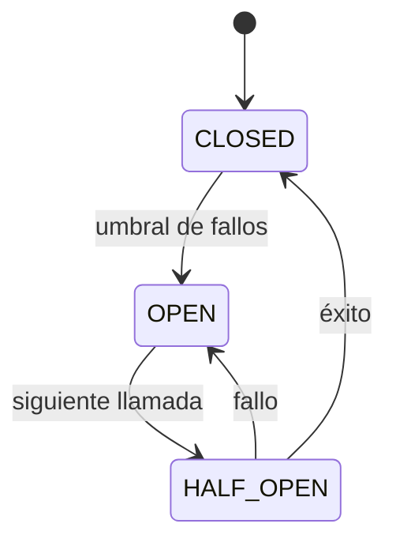

# 01. Circuit Breaker

**ES.** El breaker cuenta fallos; al alcanzar el umbral pasa de CLOSED a OPEN. La siguiente llamada actúa como sondeo HALF-OPEN: si responde bien vuelve a CLOSED; si falla, vuelve a OPEN. Es una simulación local en memoria.

**EN.** The breaker counts failures and opens at the threshold. The next call is a HALF-OPEN probe; success closes it, failure reopens it. This is an in-memory local simulation.

Requires Python 3.12 and pytest. `python circuit_breaker.py` demonstrates the transition; `pytest -q` runs automated checks. There is no service to stop.

**Observed run (Python 3.14):** `2 passed`; demo logs: `fallo 1: CLOSED`, `fallo 2: OPEN`, `fallo 3: OPEN`, `probe state: HALF-OPEN`, `probe: ok CLOSED`.

**GitHub:** [add repository URL]
