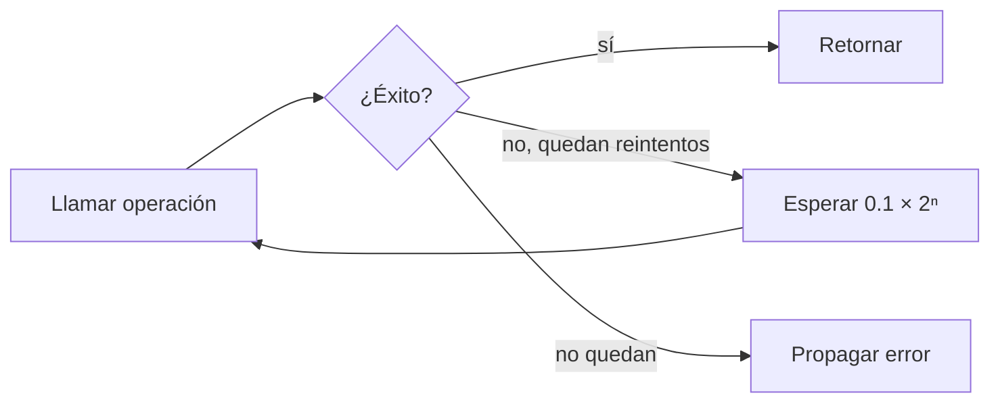

# 02. Retry

**ES.** Repite una operación hasta tres veces después del intento inicial. El backoff exponencial espera 0.1, 0.2 y 0.4 segundos por defecto. Los tests reemplazan la espera para no ralentizarse.

**EN.** Retries an operation up to three times after the initial call. Exponential backoff waits 0.1, 0.2, then 0.4 seconds by default. Tests inject a no-op wait.

Requires Python 3.12 and pytest. Run `python retry_demo.py`; verify with `pytest -q`. No service to stop.

**Observed run (Python 3.14):** `2 passed`; demo logs: `ok`, `intentos: 3`.

**GitHub:** [add repository URL]
