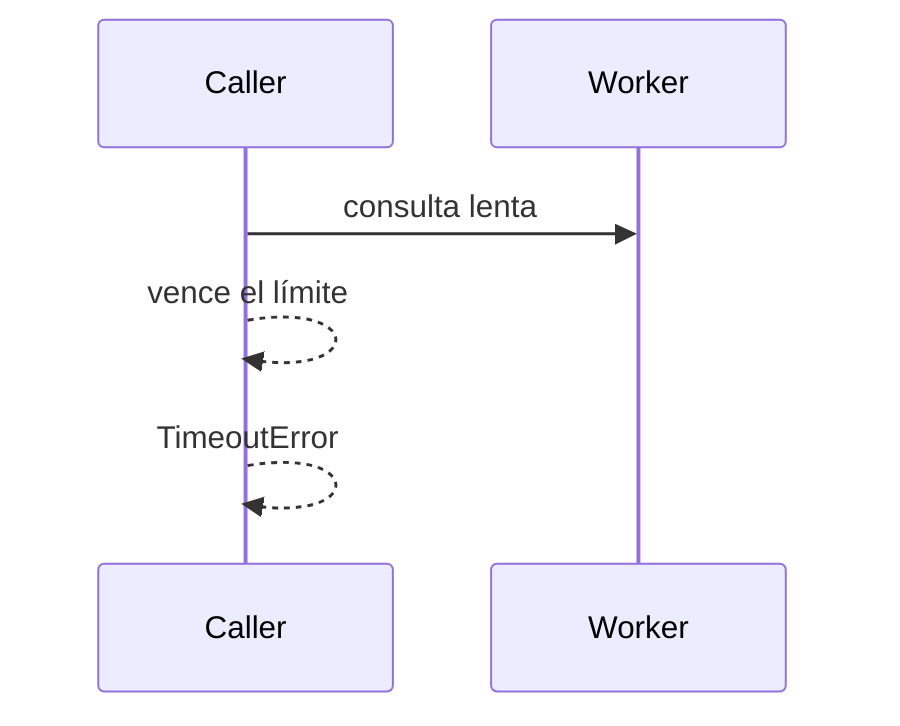

# 03. Timeout

**ES.** Ejecuta la consulta en un hilo y limita cuánto espera el llamador. Python no puede terminar con seguridad un hilo que ya está ejecutándose; el ejemplo cancela tareas que aún no comenzaron y deja terminar la operación lenta en segundo plano.

**EN.** Runs a query in a worker thread and bounds caller wait time. Python cannot safely kill a running thread; this example cancels work that has not started and allows slow work to finish in the background.

Requires Python 3.12 and pytest. Run `python timeout_demo.py`; verify with `pytest -q`. No service to stop.

**Observed run (Python 3.14):** `2 passed`; demo log: `operation exceeded 0.2s`.

**GitHub:** [add repository URL]
