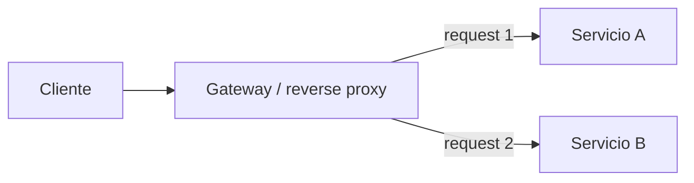

# 05. API Gateway, balanceador y reverse proxy

**ES.** El gateway verifica `X-API-Key` y reenvía `/api/health` alternadamente a dos instancias de servicio. El proxy HTTP en FastAPI cumple el rol de reverse proxy; el ciclo demuestra distribución local, no un balanceador administrado de AWS.

**EN.** The gateway checks `X-API-Key` and alternates `/api/health` between two service instances. Its HTTP forwarding acts as a reverse proxy; the local cycle demonstrates distribution, not an AWS managed load balancer.

Requires Docker Compose. Start with `docker compose up --build`; call `curl -H "X-API-Key: demo-token" http://localhost:8000/api/health` twice and expect service-a then service-b. Missing key returns 401. The fixed token is for local demonstration only; override `API_TOKEN` outside local exercises. Stop with `docker compose down`. Local only; no AWS resources.

**Observed run:** Compose could not start because the Docker daemon pipe was unavailable (`docker_engine` not found). FastAPI is not installed in the host Python environment, so an alternate host run was unavailable. No response behavior is claimed as executed here.

**GitHub:** [add repository URL]
