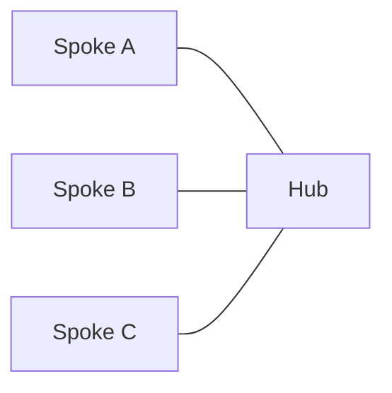

# 06. Hub-and-Spoke

**ES.** Modelo de rutas en memoria: tres spokes intercambian tráfico pasando por el hub. No crea VPC, subnets, Transit Gateway ni tráfico AWS.

**EN.** In-memory route model: three spokes communicate through the hub. It creates no VPCs, subnets, Transit Gateway, or AWS traffic.

Requires Python 3.12 and pytest. Run `python topology.py`; test with `pytest -q`. No service to stop.

**Observed run (Python 3.14):** `2 passed`. AWS networking not deployed.

**GitHub:** [add repository URL]
