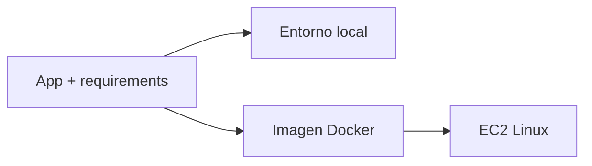

# 07. Lift-and-Shift

**ES.** Una API mínima corre en Python 3.12 localmente o en el mismo contenedor en un host Linux. El contenedor demuestra portabilidad; la migración real a EC2 requiere crear y proteger la instancia por separado.

**EN.** A minimal API runs locally on Python 3.12 or in the same container on Linux. The container demonstrates portability; a real EC2 migration requires separately provisioning and securing the instance.

Local: `python -m venv .venv`; activate it, `pip install -r requirements.txt`, `uvicorn app:app --port 8000`. Container: `docker build -t lift-demo .`; `docker run --rm -p 8000:8000 lift-demo`. Check `/health`; stop with Ctrl+C. No AWS resources created.

**Real AWS migration (not executed):** inventory OS/runtime/network/secrets and data; back up and validate the app; create an EC2 instance in a private subnet with least-privilege security groups and an instance role; install Docker or Python 3.12; transfer a reviewed image/artifact over a secure channel; configure environment and health checks; test via a load balancer or controlled SSH tunnel; cut over DNS only after validation; retain rollback and remove the old host after acceptance. EC2, EBS, networking and data transfer can incur charges; obtain authorization before provisioning.

**Observed run:** pending execution in this environment.

**GitHub:** [add repository URL]
